# if — an AI cartoon micro-series

**Episode 1 · *the art of timing…*** · written and directed by Jérémie Borrotzu (Lyon, France)

[English](#english) · [Français](#français)

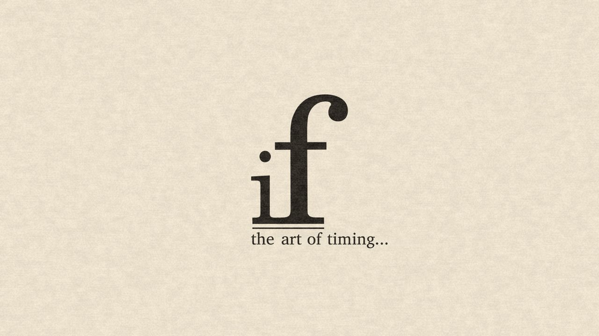

---

## English

### The film

Zak, a stubborn caveman, strikes his flints day and night trying to make fire. A hand appears out of nowhere
and offers him a lighter… But having the right tool isn't enough: you still have to know how to use it.

**if** is an AI-assisted animated micro-series with a simple concept: drop an invention from one era into another,
in front of someone who has no idea how to use it. Each episode is a single fixed shot, framed by a vertical
camera move from the sky to the scene and back, with a voice-over at the start and the end. Episode 1 was made
in about 3 days of production, for a family audience (6–12 and up).

| | |
|---|---|
| 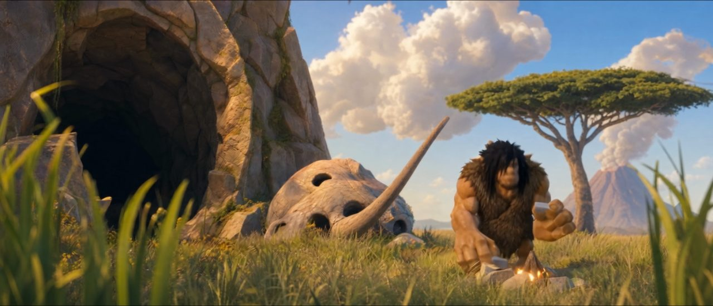 | 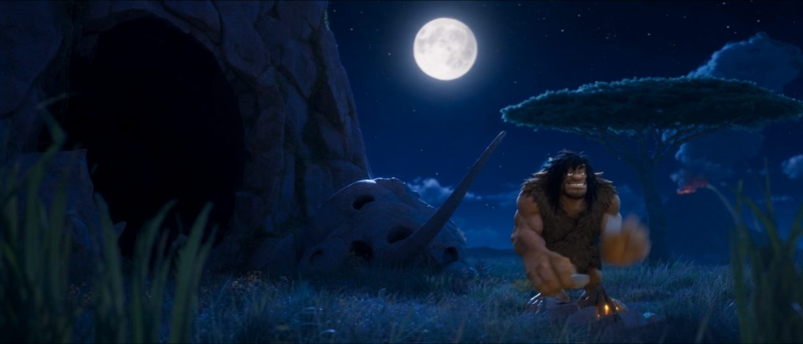 |
| 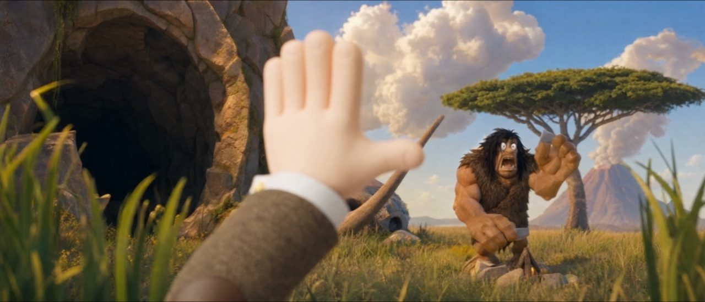 | 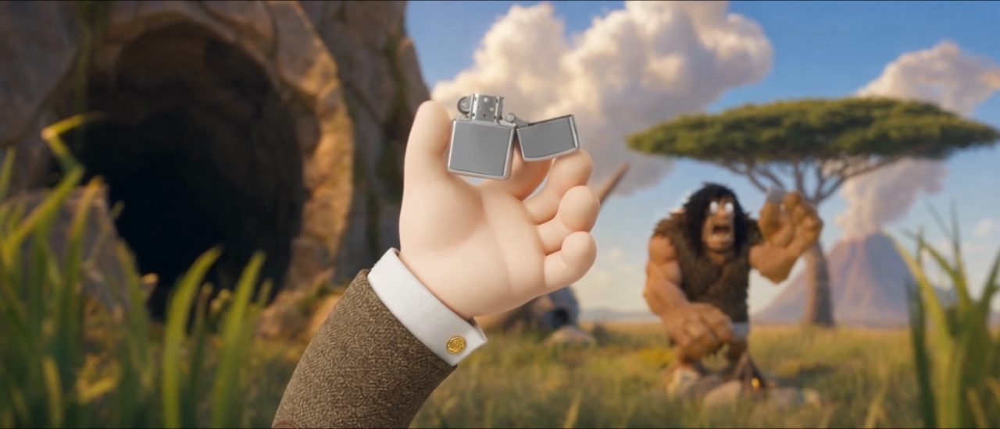 |

### The point: a hand-drawn style, carried through every AI step

Most AI animation looks like everyone else's. This project starts from **the director's own drawings** and
protects that line through every step: sketch → style bible → turnaround → 3D model → rig → painted set →
video → motion design coded by hand.

| From sketch… | …to turnaround… | …to 3D |
|---|---|---|
| 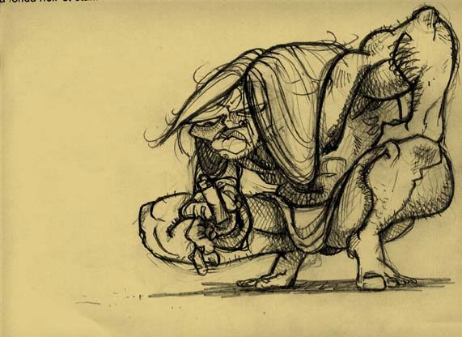 | 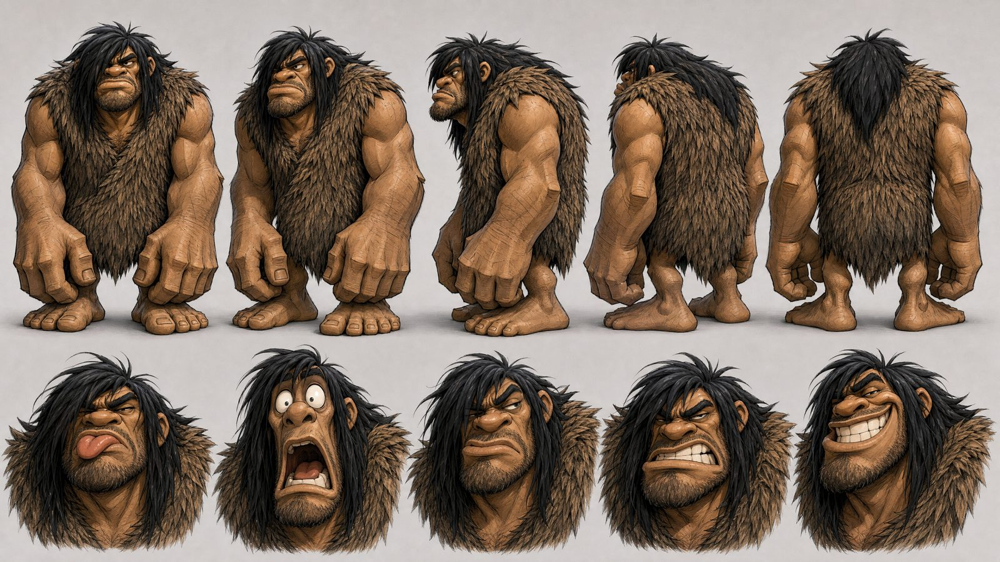 | 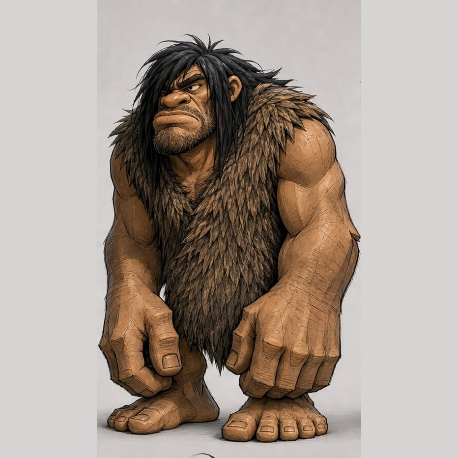 |

| Hyper3D mesh vs. blockout | Hand-split parts for the rig | Rig in Blender | Textured model |
|---|---|---|---|
| 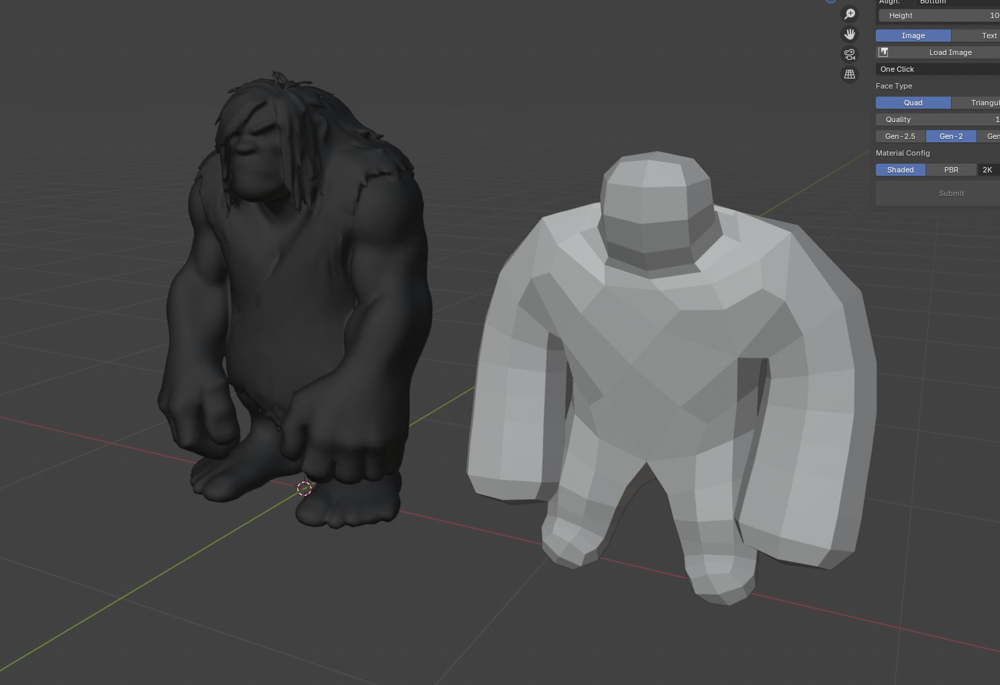 | 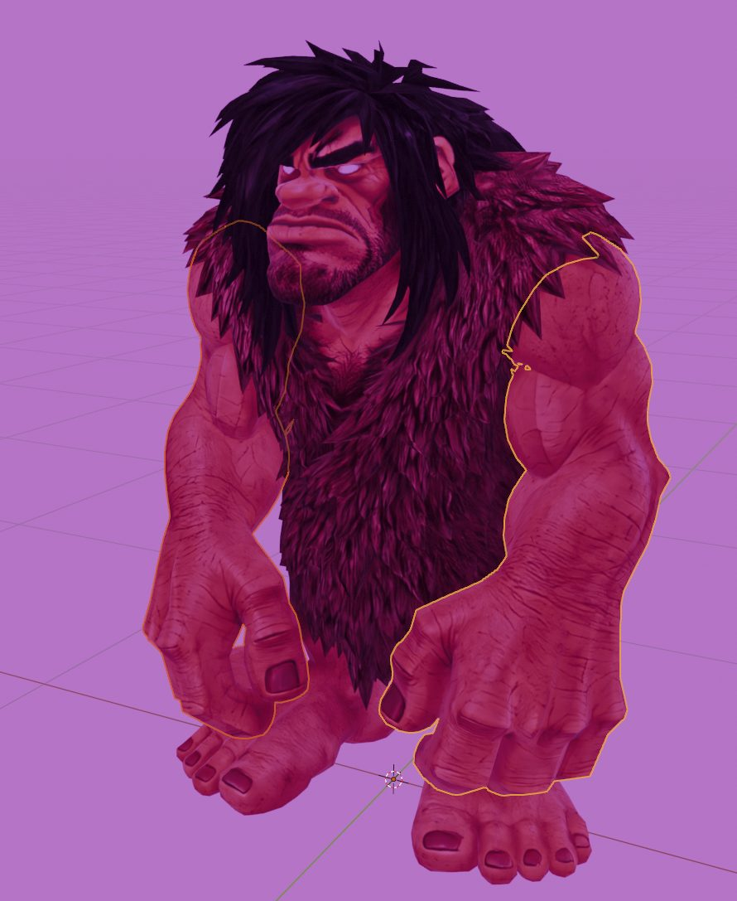 | 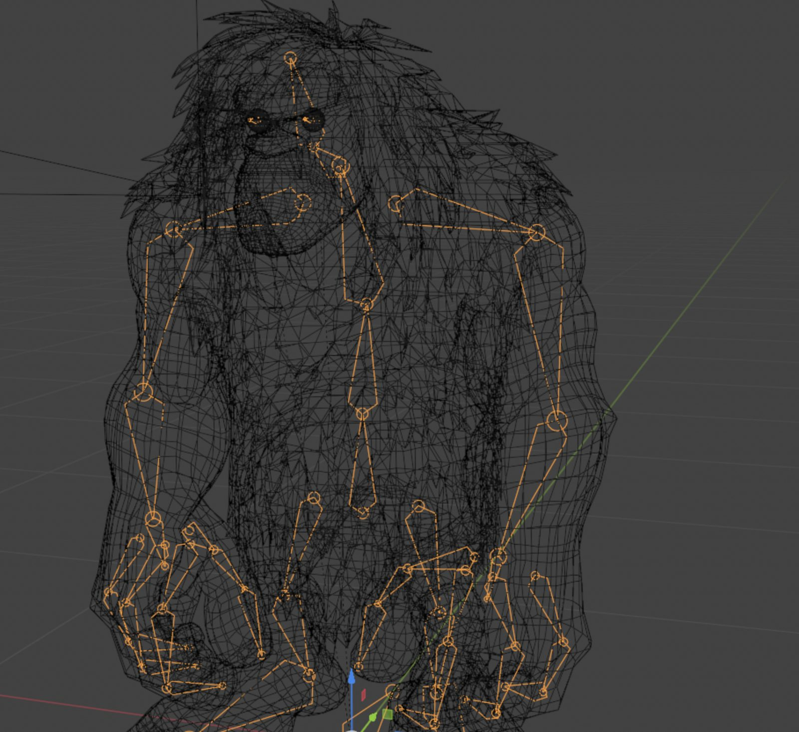 | 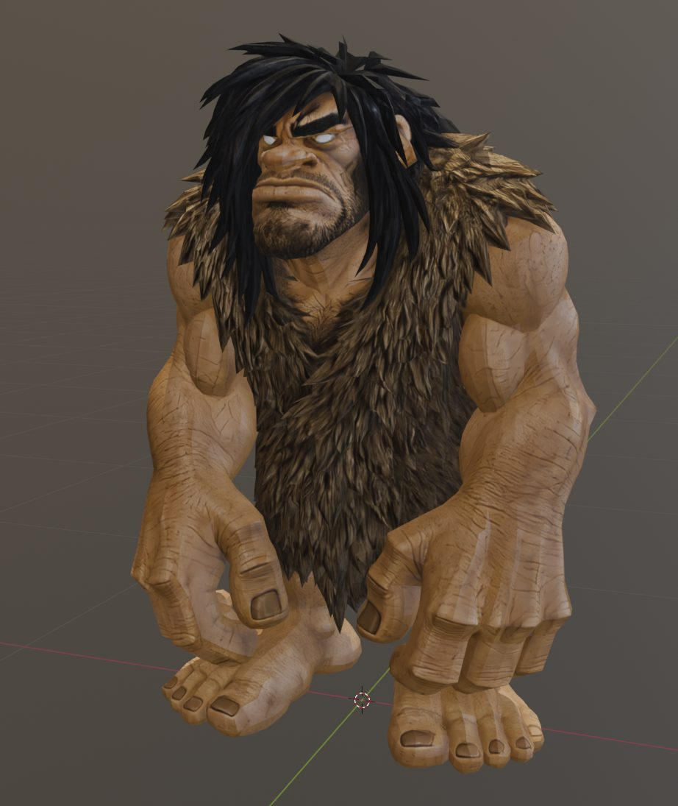 |

| Set, paper sketch | Set, painted from the Blender layout |
|---|---|
| 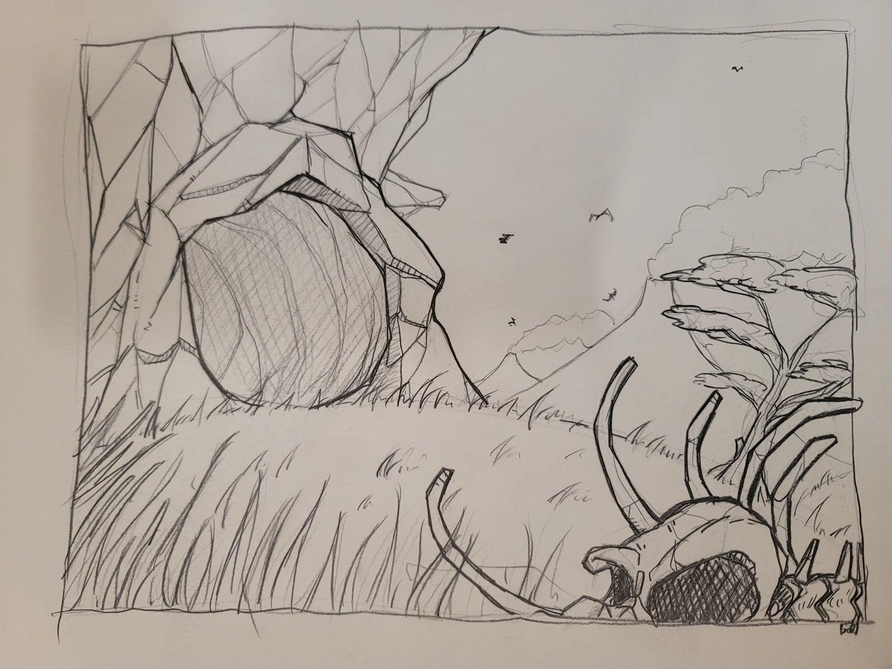 | 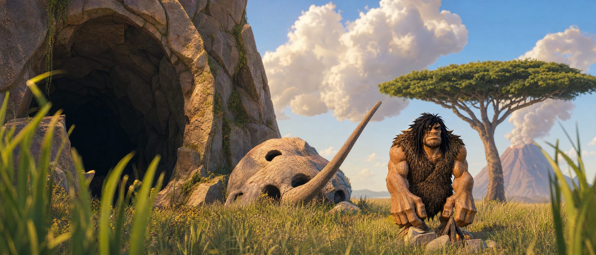 |

### Pipeline in 7 steps

| # | Step | Tools | Who |
|---|---|---|---|
| 1 | Concept and gag choreography, beat by beat | [docs/CONCEPT.md](docs/CONCEPT.md) | director |
| 2 | Style bible extracted from 42 of the director's drawings, one prompt block reused everywhere | [docs/STYLE_BIBLE.md](docs/STYLE_BIBLE.md) | director + agent |
| 3 | Turnaround and expressions, then 3D model and rig | GPT Image 2, Astra, Hyper3D Rodin, Blender | director + agent |
| 4 | Set built and lit in Blender (fixed 21:9 camera, vertical move), then painted over | Blender via MCP, Astra | agent |
| 5 | The gag shot, step by step: each extension continues the previous one | Seedance 2.5 on Runway | director |
| 6 | Title, intro typography, transitions and credits, coded in Python with animation principles | [scripts/](scripts/), [docs/ANIMATION_PRINCIPLES.md](docs/ANIMATION_PRINCIPLES.md) | agent |
| 7 | Voice-over, music, edit, upscale | ElevenLabs v4, Suno, Final Cut Pro, Topaz | director |

**Orchestration:** Claude Code (Anthropic) drives Blender through the Model Context Protocol (MCP), writes the
prompts and the motion-design code, and logs every decision. **AI executes, humans direct.**

Full method and lessons: [docs/PIPELINE.md](docs/PIPELINE.md).

### Motion design, coded

The title, the intro typography, the "démonstration…" card and the credits are not generated: they are Python
programs that apply classic animation rules (anticipation, arcs, overlap, weight, takes), timed word by word on
the voice-over with Whisper.

| | |
|---|---|
| 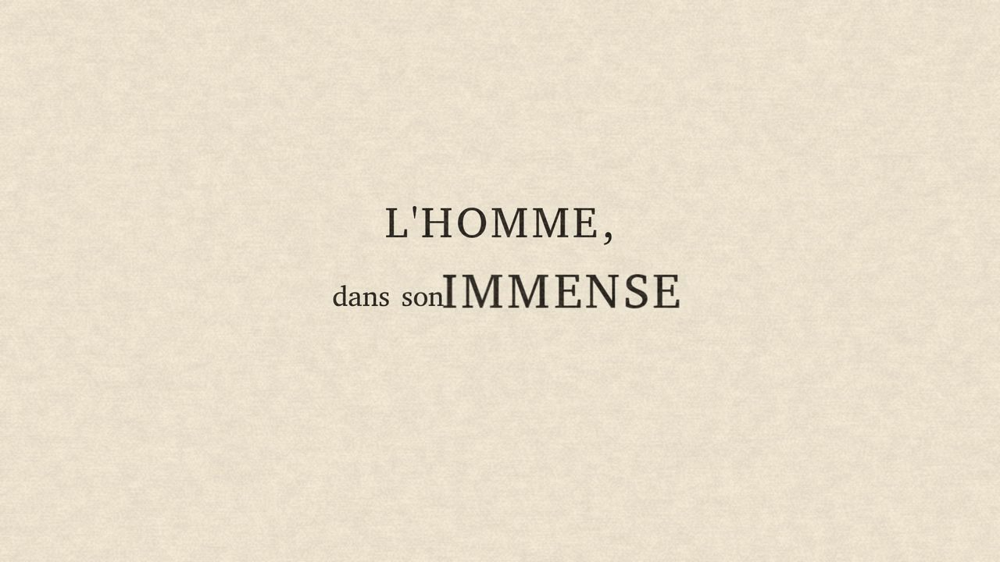 | 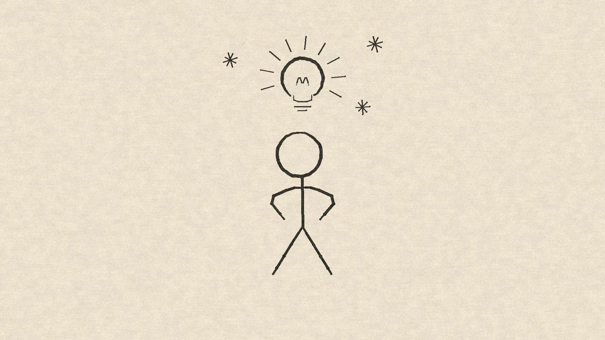 |

### Repository map

```
docs/       Concept, style bible, animation principles, pipeline (EN + FR), production log (FR)
prompts/    Real prompts used for the turnaround, the hand, the title, the set and the lighter gag
scripts/    Python motion design: title, intro (4 versions), credits, edit helpers
images/     Stills and process images (compressed)
```

Prompts and the production log are kept in their original form (mostly English prompts, French notes).
No video, audio, 3D or source files are published here.

### Credits

Written, directed and character design by **Jérémie Borrotzu**.
Stack: Claude Code (Anthropic) · Hyper3D Rodin (Deemos) · Blender · GPT Image 2 · Astra · Grok Imagine ·
Nano Banana · Runway, Seedance 2.5 · Suno · ElevenLabs v4 · Python · Final Cut Pro · Topaz.

© Jérémie Borrotzu. Characters, story, drawings and images: all rights reserved. Shared for reading and learning.

---

## Français

### Le film

Zak, homme de Cro-Magnon obstiné, tape ses silex jour et nuit pour faire du feu. Une main surgie de nulle part
lui tend un briquet… Mais avoir le bon outil ne suffit pas : encore faut-il savoir s'en servir.

**if** est une micro-série d'animation assistée par IA au concept simple : on place, dans une époque, une
invention venue d'une autre, face à quelqu'un qui ne sait pas s'en servir. Chaque épisode est un seul plan fixe,
encadré par un mouvement vertical du ciel vers la scène et retour, avec une voix off au début et à la fin.
L'épisode 1 a été produit en 3 jours environ, pour un public familial (6-12 ans et plus).

### L'enjeu : garder un trait dessiné à la main à chaque étape IA

La plupart des animations IA se ressemblent. Ce projet part **des dessins du réalisateur** et protège ce trait à
chaque étape : croquis → bible de style → turnaround → modèle 3D → rig → décor peint → vidéo → motion design codé.

### Le pipeline en 7 étapes

| # | Étape | Outils | Qui |
|---|---|---|---|
| 1 | Concept et chorégraphie du gag, temps par temps | [docs/CONCEPT_FR.md](docs/CONCEPT_FR.md) | réalisateur |
| 2 | Bible de style tirée de 42 dessins du réalisateur, un bloc de prompt réutilisé partout | [docs/STYLE_BIBLE_FR.md](docs/STYLE_BIBLE_FR.md) | réalisateur + agent |
| 3 | Turnaround et expressions, puis modèle 3D et rig | GPT Image 2, Astra, Hyper3D Rodin, Blender | réalisateur + agent |
| 4 | Décor construit et éclairé dans Blender (caméra fixe 21:9, mouvement vertical), puis repeint | Blender via MCP, Astra | agent |
| 5 | Le plan du gag, étape par étape : chaque extension prolonge la précédente | Seedance 2.5 sur Runway | réalisateur |
| 6 | Titre, typographie d'intro, transitions et générique codés en Python selon les principes d'animation | [scripts/](scripts/), [docs/ANIMATION_PRINCIPLES_FR.md](docs/ANIMATION_PRINCIPLES_FR.md) | agent |
| 7 | Voix off, musique, montage, upscale | ElevenLabs v4, Suno, Final Cut Pro, Topaz | réalisateur |

**Orchestration :** Claude Code (Anthropic) pilote Blender via le Model Context Protocol (MCP), écrit les prompts
et le code du motion design, et consigne chaque décision. **L'IA exécute, l'humain dirige.**

Méthode complète et leçons : [docs/PIPELINE_FR.md](docs/PIPELINE_FR.md). Journal de production : [docs/PRODUCTION_LOG_FR.md](docs/PRODUCTION_LOG_FR.md).

### Crédits

Écrit, réalisé et character design par **Jérémie Borrotzu**.
© Jérémie Borrotzu. Personnages, histoire, dessins et images : tous droits réservés. Partagé pour la lecture et l'apprentissage.
