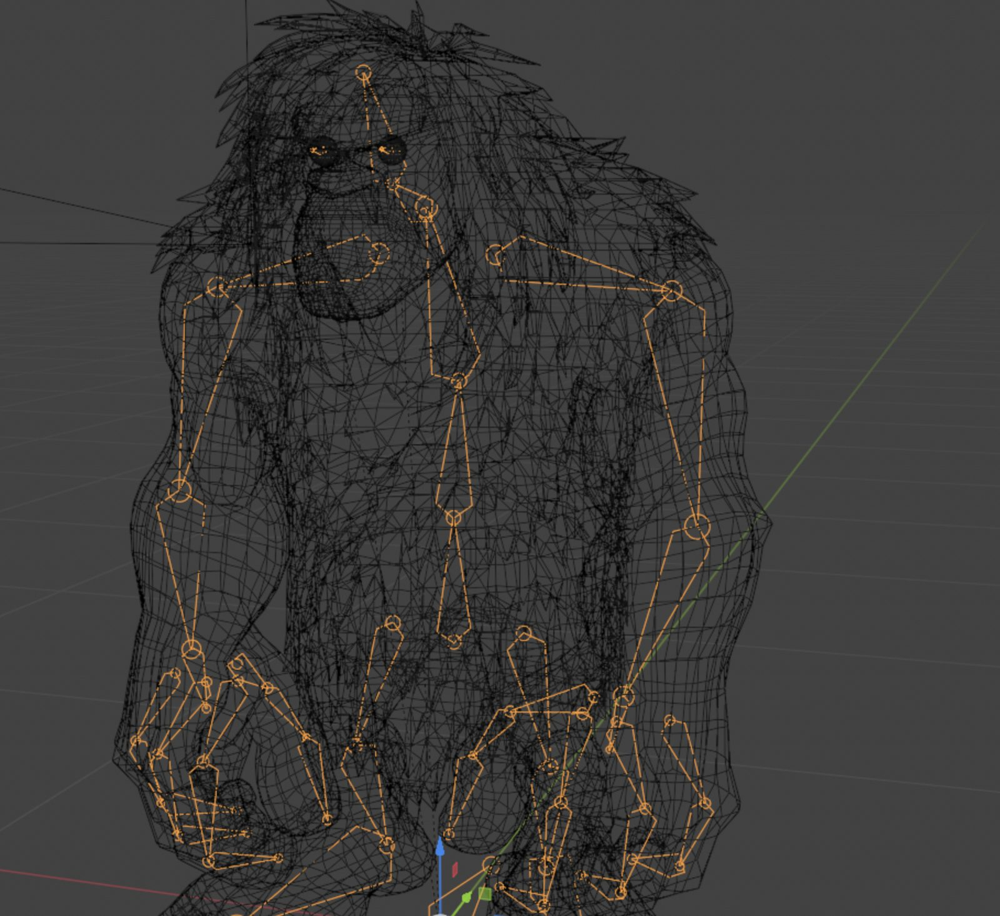
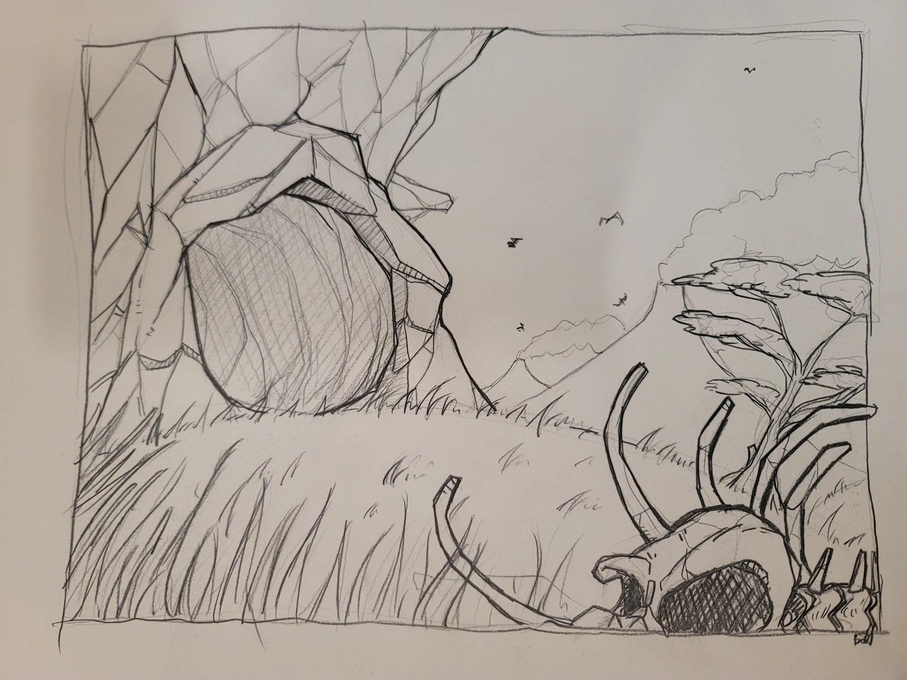
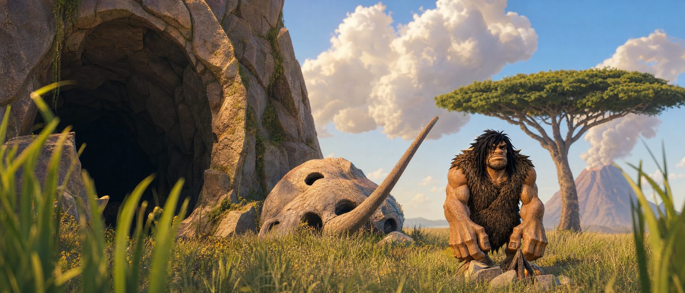

# Pipeline and lessons — if, episode 1

*Version française : [PIPELINE_FR.md](PIPELINE_FR.md)*

## 1. Character: from the director's sketch to a rigged 3D model
1. **Style bible** extracted from 42 of the director's drawings ([STYLE_BIBLE.md](STYLE_BIBLE.md)), with one style
   prompt block pasted into every image generation.
2. **Turnaround + expressions** generated with Astra, then edited towards caricature
   ([prompts/01_turnaround](../prompts/01_turnaround)). The caricature v2 sheet became the base.
3. **3D model** with Hyper3D Rodin in agentic mode, from the sheet (≈ 9,600 faces, mostly quads, PBR textures).
4. **Rig in Blender**, driven live through MCP with the director: body split by hand into torso/head, arms and legs;
   spine, arms, legs, 4 fingers × 3 phalanges per hand, separate eyeballs and eye bones. Each part is weighted only
   to its own bones.

## 2. Set: Blender layout, then repainted
1. The set is built in Blender: a fixed 21:9 shot, slight low angle, a vertical sky → scene move, shallow depth of
   field on Zak; cave, rocks, fire pit, plain, distant volcano, pterodactyls, procedural grass.
2. The layout render is repainted with Astra. **Lesson:** a prompt that stays too close to the blockout gives a
   blockout. Version 2, "use the layout only, repaint everything", was the one approved
   ([prompts/04_set](../prompts/04_set)).

| Paper sketch | Final painted set |
|---|---|
|  |  |

## 3. The gag shot: one long take, built step by step
The whole gag is **one fixed shot**, built with Seedance 2.5 on Runway as a chain of extensions, one generation
per step, in order ([prompts/05_lighter_gag](../prompts/05_lighter_gag)):

| Step | What we see |
|---|---|
| 1 | Zak strikes his flints (from a Blender animation + style references) |
| 2 | Extension: a bored sigh, frantic striking, comic faces, day/night cycle, still no fire |
| 3 | The hand bursts in from below: STOP, lighter trick in the foreground, background blurred |
| 3b | STOP + lighter re-done from a keyframe |
| 4 | The hand returns from the right, snaps its fingers, hands over the lighter; Zak freezes, takes it |
| 5-6 | Two endings: Zak's "trick" (acting, fixed camera) and the final camera lift |

## 4. Motion design, coded in Python
Title, intro typography, transition card and credits are Python programs ([scripts/](../scripts)), timed word
by word on the edited voice-over with a local Whisper model, and built on the rules in
[ANIMATION_PRINCIPLES.md](ANIMATION_PRINCIPLES.md): anticipation, arcs, overlap, accelerating falls, takes,
paper grain and printed-ink texture, native 24 fps with recalculated motion blur. Four intro versions were made
(doodle, animated typography, single morphing line, mid-century poster).

## 5. Lessons learned
1. **Never remove a prompt block that works.** Removing one "to simplify" broke a shot that was already right.
2. **The pose described in the prompt must match the keyframe.** If the text says one pose and the image shows
   another, the model hesitates and the shot wobbles.
3. **Never reverse an animation to get the opposite move.** Easings and physics play backwards and it shows.
   Animate the real move (the closing camera lift was animated, not reversed).
4. **"Layout only, repaint everything"** when turning a 3D blockout into a painted image; otherwise you get the blockout back.
5. **The edited voice-over is the timing reference**, not the raw takes: every animation is re-timed on the
   director's cut.
6. **One generation at a time**, with an explicit go-ahead, and every decision written in the production log
   ([PRODUCTION_LOG_FR.md](PRODUCTION_LOG_FR.md)).
