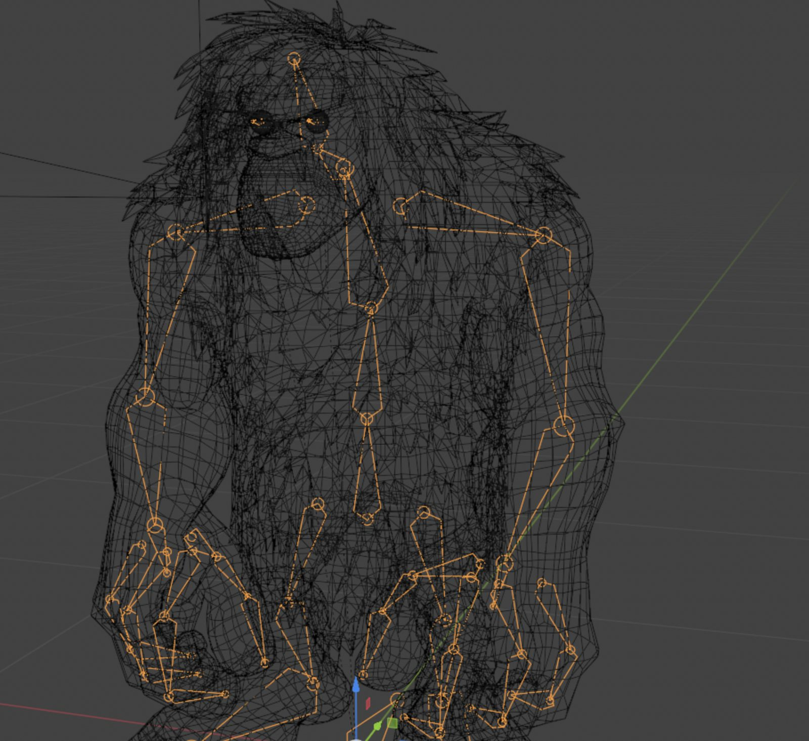
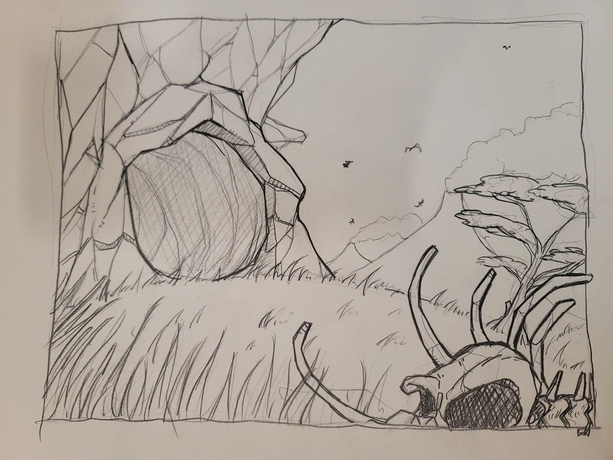
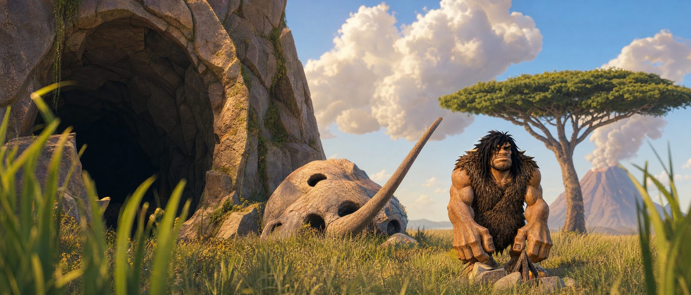

# Pipeline et leçons — if, épisode 1

*English version: [PIPELINE.md](PIPELINE.md)*

## 1. Le personnage : du croquis du réalisateur au modèle 3D riggé
1. **Bible de style** tirée de 42 dessins du réalisateur ([STYLE_BIBLE_FR.md](STYLE_BIBLE_FR.md)), avec un bloc de
   prompt « style » collé dans chaque génération d'image.
2. **Turnaround + expressions** générés avec Astra, puis retouchés vers la caricature
   ([prompts/01_turnaround](../prompts/01_turnaround)). La planche « caricature v2 » est devenue la base.
3. **Modèle 3D** avec Hyper3D Rodin en mode agentique, depuis la planche (≈ 9 600 faces, surtout des quads, textures PBR).
4. **Rig dans Blender**, piloté en direct via MCP avec le réalisateur : corps découpé à la main en buste/tête, bras et
   jambes ; colonne, bras, jambes, 4 doigts × 3 phalanges par main, globes oculaires et os des yeux séparés. Chaque
   partie n'est pondérée que sur ses propres os.

## 2. Le décor : mise en place Blender, puis repeint
1. Le décor est construit dans Blender : plan fixe 21:9, légère contre-plongée, travelling vertical ciel → scène,
   faible profondeur de champ sur Zak ; grotte, rochers, foyer, plaine, volcan lointain, ptérodactyles, herbe procédurale.
2. Le rendu de mise en place est repeint avec Astra. **Leçon :** un prompt trop collé au blockout redonne un
   blockout. La version 2, « garde seulement la mise en place, repeins tout », a été validée
   ([prompts/04_set](../prompts/04_set)).

| Croquis papier | Décor peint final |
|---|---|
|  |  |

## 3. Le plan du gag : un seul plan, construit étape par étape
Tout le gag est **un seul plan fixe**, construit avec Seedance 2.5 sur Runway en une chaîne d'extensions, une
génération par étape, dans l'ordre ([prompts/05_lighter_gag](../prompts/05_lighter_gag)) :

| Étape | Ce qu'on voit |
|---|---|
| 1 | Zak tape ses silex (depuis une animation Blender + références de style) |
| 2 | Extension : soupir blasé, frappe frénétique, grimaces, cycle jour/nuit, toujours pas de feu |
| 3 | La main surgit par le bas : STOP, tour du briquet au premier plan, arrière-plan flou |
| 3b | STOP + briquet refaits depuis une image clé |
| 4 | La main revient par la droite, claque des doigts, tend le briquet ; Zak se fige, le prend |
| 5-6 | Deux fins : la « ruse » de Zak (jeu d'acteur, caméra fixe) et la montée finale de la caméra |

## 4. Le motion design, codé en Python
Titre, typographie d'intro, panneau de transition et générique sont des programmes Python ([scripts/](../scripts)),
calés au mot près sur la voix off montée grâce à un modèle Whisper local, et construits sur les règles de
[ANIMATION_PRINCIPLES_FR.md](ANIMATION_PRINCIPLES_FR.md) : anticipation, arcs, chevauchement, chutes qui
accélèrent, takes, grain papier et encre imprimée, 24 i/s natif avec flou de mouvement recalculé. Quatre versions
de l'intro ont été faites (doodle, typographie animée, ligne unique qui se transforme, affiche mid-century).

## 5. Leçons apprises
1. **Ne jamais retirer un bloc de prompt qui marche.** En retirer un « pour simplifier » a cassé un plan qui était juste.
2. **La pose décrite dans le prompt doit être celle de l'image clé.** Si le texte dit une pose et l'image en montre
   une autre, le modèle hésite et le plan flotte.
3. **Ne jamais inverser une animation pour obtenir le mouvement contraire.** Les amortis et la physique se jouent
   à l'envers, et ça se voit. On anime le vrai mouvement (la montée finale de la caméra a été animée, pas inversée).
4. **« Garde seulement la mise en place, repeins tout »** pour transformer un blockout 3D en image peinte ; sinon on
   récupère le blockout.
5. **La voix off montée fait foi pour le calage**, pas les prises brutes : chaque animation est recalée sur la
   coupe du réalisateur.
6. **Une génération à la fois**, avec un accord explicite, et chaque décision écrite dans le journal de production
   ([PRODUCTION_LOG_FR.md](PRODUCTION_LOG_FR.md)).
